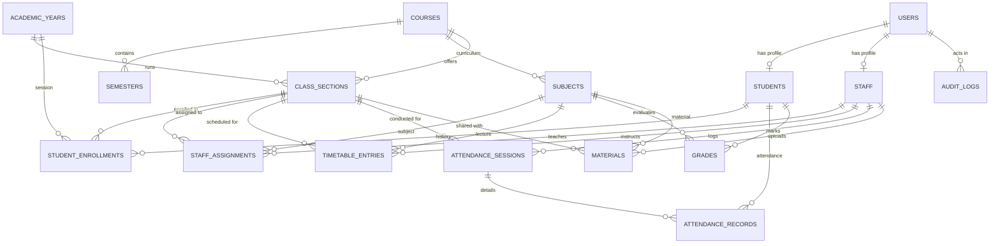

# Department Management Portal 
> **Note:** Source code is not available because this was developed as a freelance project.
### Sriram College of Arts and Science — Department of Computer Science


A comprehensive, database-driven, enterprise-grade academic management system designed specifically for the **Department of Computer Science** at **Sriram College of Arts and Science**.

The portal serves both department programmes:
- **B.Sc. Computer Science** (3 Years — 6 Semesters)
- **M.Sc. Computer Science** (2 Years — 4 Semesters)

---

## 🌟 Key Highlights & Architectural Principles

1. **100% Database-Driven Source of Truth**:
   - Zero hardcoded student names, staff details, classes, subjects, semesters, or timetable slots.
   - Initial data imported from Excel workbooks directly into normalized PostgreSQL tables.
   - The application does **not** rely on Excel files during runtime.

2. **Strict Dual-Layer Role-Based Access Control (RBAC)**:
   - Permissions enforced on **both** backend API endpoints (via FastAPI dependency guards) and frontend routes (via React ProtectedRoute).
   - Role spoofing defense: The backend verifies email, password, and *actual* database account role. A student selecting "Administrator" on the login dropdown is strictly rejected.

3. **High-Performance Monorepo Architecture**:
   - Clean, modular separation between `backend/`, `frontend/`, `initial_data/`, and development scripts.
   - Fully automated migrations managed by Alembic.
   - Comprehensive automated test suite covering all critical workflows with `pytest`.

---

## 👥 Three Dedicated User Portals

### 1. Student Portal (`STUDENT`)
- **Dashboard**: Instant view of current semester, active class, overall attendance rate, SGPA/CGPA summary, and today's lecture schedule.
- **My Profile**: Comprehensive academic profile, personal contacts, parent/guardian info, and chronological semester enrollment history.
- **Attendance Record**: Subject-wise attendance breakdown, attended vs total classes, condonation percentage threshold indicator (&ge; 75%), and day-by-day lecture logs.
- **Examination Grades**: Continuous Internal Assessments (CIA 1, CIA 2), Model Exams, and University Semester Results with grade points and pass/fail indicators.
- **Weekly Timetable**: Interactive day-by-day lecture matrix showing subjects, timings, faculty names, and lab/room assignments.
- **Study Materials**: Centralized downloads of syllabus notes, lab manuals, question banks, and reference PDFs uploaded by faculty.

### 2. Staff / Faculty Portal (`STAFF`)
- **Dashboard**: Assigned subjects, assigned classes, scheduled periods today, and quick attendance launchers.
- **Daily Attendance Marking**: 1-tap roll-call marking for assigned classes. Automatically sets entire roster to PRESENT with single-tap toggle to ABSENT or ON_DUTY.
- **Study Material Publishing**: Upload lecture notes, code samples, and PDFs targeted directly to assigned subjects and sections.
- **Faculty Timetable**: Personal weekly teaching schedule across all classes.
- **Faculty Profile**: Contact records and current subject/class assignment allocations.

### 3. Administrator / Head of Department Portal (`ADMIN` / `HOD`)
- **Executive Dashboard**: Real-time department KPIs (total enrolled students, active faculty, classes, subjects, overall attendance rate).
- **Student Management**: Full CRUD, search, filter by programme/year/section, student detail profile with enrollment history.
- **Staff Management**: Faculty directories, contact records, and teaching load tracking.
- **Academic Year & Semester Management**: Academic session configuration (2026-2027) and semester definitions.
- **Class & Section Management**: Section allocation (Year 1, 2, 3 / Sections A, B), room numbers, and student count auditing.
- **Subject Curriculum Management**: Course syllabi, theory/practical classifications, credit points, and semester mappings.
- **Staff-to-Class-to-Subject Assignments**: 1-step assignment interface allocating faculty to specific class subjects.
- **Bulk Student Promotion Engine**: 1-click transactional promotion of entire classes between semesters and academic years (e.g. Sem 1 &rarr; Sem 2, Year 1 &rarr; Year 2). Preserves complete historical records by marking previous enrollments as `is_current = False`.
- **Master Timetable Management**: Visual weekly interactive timetable grid with built-in conflict prevention (detects faculty double-booking and room collisions).
- **Attendance Monitoring & Audit**: Department-wide lecture session review, condonation defaulter tracking (< 75%), and individual student roll-call drill-downs.
- **Examination & Grade Management**: Continuous assessment marks entry, model exam recording, end-semester results, and automated university letter grade/CGPA calculations.
- **Department Material Repository**: Central repository to inspect, audit, download, or manage all study materials.
- **Excel Data Importer**: Multi-category Excel workbook ingestion (Students, Staff, Subjects, Classes) with real-time pre-validation, duplicate detection, and batch audit tracking.
- **System Audit Trail**: Immutable log of administrative actions (promotions, grade updates, assignments, imports) with actor details, timestamps, and IP addresses.
- **System & Institutional Settings**: Department configurations and live database engine health check.

---

## Account Access

The repository does not provide shared demo credentials. To provision a missing local administrator, set `DEFAULT_ADMIN_EMAIL` and `INITIAL_ADMIN_PASSWORD` for a one-time `python -m app.database.init_admin` run from `backend`; the password must meet the administrator policy. The command leaves existing accounts unchanged unless an explicit password-reset flag is passed. Administrator accounts must complete authenticator MFA during their next sign-in.

---
## 🚀 Quick Start (Windows Development)

### Method 1: 1-Click Batch Script (Recommended)
Simply double-click:
```bat
start-dev.bat
```
or run from PowerShell:
```powershell
.\start-dev.ps1
```
This script will:
1. Detect and verify PostgreSQL status on port `5432`.
2. Apply all database migrations via Alembic.
3. Launch the FastAPI backend on `http://127.0.0.1:8000`.
4. Launch the React Vite frontend on `http://localhost:5173`.
5. Open your default web browser to the login page.

---

### Method 2: Manual Terminal Startup

#### 1. Backend Setup
The steps below are for a disposable local development database only. Do not run the seed script against production; it is not a production data repair tool. Configure `DATABASE_URL`, `JWT_SECRET`, and `MFA_ENCRYPTION_KEY` before starting the application.

```powershell
cd backend
python -m venv venv
.\venv\Scripts\Activate.ps1
pip install -r requirements.txt

# Run migrations and optional development-only seed data
alembic upgrade head
python -m app.database.seed

# Launch backend
uvicorn app.main:app --reload --host 127.0.0.1 --port 8000
```
Backend API will be live at:
- Application Base: `http://127.0.0.1:8000`
- Interactive Swagger Documentation: `http://127.0.0.1:8000/docs`
- ReDoc Documentation: `http://127.0.0.1:8000/redoc`

#### 2. Frontend Setup
```powershell
cd frontend
npm ci
npm run dev
```
Frontend will be live at: `http://localhost:5173`

---

## 🐳 Docker / Docker Compose Setup

Run the entire full-stack application (PostgreSQL + FastAPI + Nginx React Frontend) in isolated containers:

```bash
docker-compose up --build
```

Access points:
- **Frontend Portal**: `http://localhost` (Port 80)
- **Backend API**: `http://localhost:8000`
- **PostgreSQL Database**: `localhost:5432`

---

## 📊 Database Architecture & Relationships



### Key Data Integrity Safeguards:
- `StudentEnrollment`: Tracks every student's semester progression. Current active enrollment is marked with `is_current = True`. Historical semesters remain preserved with `is_current = False`.
- `TimetableEntry`: Enforces uniqueness on `(staff_id, day_of_week, period_number)` to prevent faculty double-booking, and on `(class_id, day_of_week, period_number)` to prevent classroom collision.
- `AuditLog`: Immutable audit trail recording administrative actions with actor email, action type, entity name, entity ID, JSON details, and client IP address.

---

## 🧪 Automated Test Suite

The portal includes 11 comprehensive automated test suites covering all 16 required architectural scenarios:

```powershell
cd backend
pytest tests/test_backend.py -v
```

### Test Coverage Breakdown:
1. `test_login_success`: Validates JWT token generation for Student, Staff, and Admin roles.
2. `test_role_mismatch_rejected`: Verifies security guard rejects mismatched role attempts (e.g. Student choosing Administrator).
3. `test_admin_endpoints_blocked_for_students`: Enforces 403 Forbidden when students attempt to access administrative routes.
4. `test_staff_cannot_access_other_staff_attendance`: Verifies staff cannot mark attendance for classes they are not assigned to.
5. `test_attendance_marking_and_student_visibility`: Confirms marked attendance sessions immediately reflect in the student's personal attendance summary.
6. `test_material_upload_and_visibility`: Confirms uploaded course materials are visible and downloadable by enrolled students.
7. `test_bulk_student_promotion_transaction`: Validates atomic bulk student promotion, updating current enrollments while preserving historical records.
8. `test_excel_importer_duplicate_handling`: Ensures Excel importer detects duplicate register numbers without crashing or creating corrupted records.
9. `test_audit_logging_on_promotion`: Verifies that bulk promotions generate permanent audit log entries with metadata.
10. `test_grade_cgpa_calculation`: Validates grade point mapping (O &rarr; 10, A+ &rarr; 9, etc.) and accurate semester CGPA computation.
11. `test_timetable_collision_prevention`: Verifies the database rejects scheduling the same faculty member into two different classes in the same period.

---

## 📁 Monorepo Folder Structure

```
department-portal/
├── backend/
│   ├── alembic/                 # Database migration scripts
│   ├── app/
│   │   ├── auth/                # JWT utilities, password hashing & dependencies
│   │   ├── core/                # Configuration and environment settings
│   │   ├── database/            # SQLAlchemy session and data seeders
│   │   ├── imports/             # Excel ingestion engine
│   │   ├── models/              # SQLAlchemy 2.x ORM models
│   │   ├── repositories/        # Database access abstractions
│   │   ├── routers/             # FastAPI REST API endpoints
│   │   ├── schemas/             # Pydantic v2 validation schemas
│   │   ├── services/            # Core business logic (Promotion, CGPA, Attendance)
│   │   ├── utils/               # Formatting and file helpers
│   │   └── main.py              # FastAPI application entrypoint
│   ├── tests/                   # Automated backend test suites
│   ├── Dockerfile               # Backend Docker build instructions
│   └── requirements.txt         # Python package dependencies
│
├── frontend/
│   ├── src/
│   │   ├── api/                 # API client and download helpers
│   │   ├── components/          # Reusable UI components (Navbar, Sidebar, Badges)
│   │   ├── context/             # Global AuthContext & session management
│   │   ├── layouts/             # AppLayout with responsive sidebar & navigation
│   │   ├── pages/
│   │   │   ├── auth/            # Login and administrator MFA setup
│   │   │   ├── student/         # Student Portal views (Attendance, Grades, Timetable, Notes)
│   │   │   ├── staff/           # Faculty Portal views (Roll-call, Uploads, Schedule)
│   │   │   └── admin/           # HOD Admin Portal views (Promotion, Import, Audit, Curricula)
│   │   ├── router/              # AppRouter with RBAC RouteGuards
│   │   ├── types/               # TypeScript interfaces and types
│   │   ├── App.tsx              # React Query & Router provider
│   │   └── main.tsx             # React entrypoint
│   ├── Dockerfile               # Frontend multi-stage Nginx container build
│   ├── nginx.conf               # Production Nginx reverse proxy configuration
│   └── package.json             # NPM dependencies & scripts
│
├── initial_data/                # Department initial Excel workbooks
│   ├── classes.xlsx             # Class sections & year levels
│   ├── staff.xlsx               # Faculty directory & designations
│   ├── subjects.xlsx            # Department course curricula
│   ├── students.xlsx            # Student admissions & contact records
│   └── timetable.xlsx           # Master weekly schedule
│
├── docker-compose.yml           # Multi-container orchestration
├── start-dev.bat                # Windows 1-click developer launcher
├── start-dev.ps1                # PowerShell development launcher
└── README.md                    # System documentation
```

---

## 🛡️ Security Architecture

- **Password Storage**: Passwords are cryptographically salted and hashed using **Bcrypt**. Plaintext passwords are never stored.
- **Session Tokens**: Industry-standard **JSON Web Tokens (JWT)** signed with HS256 algorithm and configurable expiration.
- **SQL Injection Defense**: Built entirely on **SQLAlchemy 2.x ORM** using parameterized SQL queries.
- **CORS Protection**: Whitelisted origin headers configurable via `.env`.
- **Upload Sanitization**: Uploaded filenames are sanitized with UUIDs to prevent directory traversal attacks.
- **Audit Logging**: Sensitive administrative actions (promotions, marks modification, staff assignments, Excel imports) are recorded in an append-only audit trail.

---

## 📜 Academic Regulations & Grading Scale

The grading scale follows the standard University guidelines:

| Marks Range (%) | Letter Grade | Grade Point | Performance | Result |
|---|---|---|---|---|
| 90 – 100 | **O** | 10 | Outstanding | Pass |
| 80 – 89 | **A+** | 9 | Excellent | Pass |
| 70 – 79 | **A** | 8 | Very Good | Pass |
| 60 – 69 | **B+** | 7 | Good | Pass |
| 55 – 59 | **B** | 6 | Above Average | Pass |
| 50 – 54 | **C** | 5 | Average | Pass |
| 40 – 49 (UG only) | **P** | 4 | Pass | Pass |
| < 40 (UG) / < 50 (PG) | **RA** | 0 | Re-Appear | Fail |

**Attendance Condonation Policy**:
- Students maintaining &ge; 75% attendance are eligible for end-semester examinations.
- Attendance below 75% triggers condonation warnings displayed prominently on the Student and Admin dashboards.

---

## 🏫 Institution Details

**Sriram College of Arts and Science**  
*Department of Computer Science*  
Perumalpattu, Tiruvallur — 602 024, Tamil Nadu, India.
Contact - HOD +91 96771 07586 
